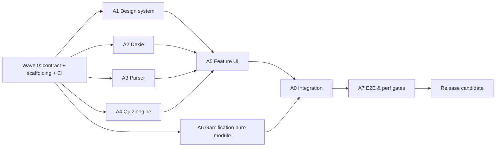

# QuizOnTap V2 — MASTER IMPLEMENTATION PLAN

> **Mục đích:** Tài liệu giao việc có thể nạp trực tiếp cho OpenCode / Claude Code / Pi hoặc nhiều coding agent. Đây là **kế hoạch**, không phải tuyên bố ứng dụng đã được viết hay kiểm thử. Phạm vi mặc định là web app trắc nghiệm *local-first*, chạy trên `localhost`, không cần backend, dùng tiếng Việt làm ngôn ngữ mặc định, nhập câu hỏi và đáp án do người dùng cung cấp.
>
> **Điểm nâng cấp so với V1:** (1) UI/UX mức sản phẩm, (2) IndexedDB thay LocalStorage cho ngân hàng đề, (3) data contract hỗ trợ câu hỏi **chưa có đáp án**, (4) pipeline nhập tài liệu kiểm tra được, (5) phân công multi-agent ít xung đột nhất, (6) skill pack / agent pack có thể đặt vào `.opencode/`, (7) test matrix, performance budgets, release checklist.

## 0. Lệnh điều hành ngắn cho AI coding

**Không triển khai tất cả trong một lượt.** Hãy đọc `AGENTS.md`, `docs/CONTRACTS.md`, `docs/TASK_BOARD.md` và tài liệu này. Làm **Wave 0** để cố định hợp đồng + foundation, sau đó chạy các luồng độc lập song song. Không cho hai agent ghi cùng file. Một người/agent chịu trách nhiệm tích hợp, chạy `typecheck → lint → unit → e2e → build`, và chỉ đánh dấu task Done khi chứng minh được acceptance criteria. Không tự bịa đáp án còn thiếu. Không gọi là “hoàn thành” khi chỉ mới tạo component mà chưa nối luồng người dùng.

### Quyết định kiến trúc đã chốt

| Khía cạnh | Quyết định V2 | Vì sao |
|---|---|---|
| Frontend | React + TypeScript strict + Vite | SPA gọn, chạy localhost nhanh |
| Styling | Tailwind CSS v4 + design tokens CSS | Dễ thống nhất UI, responsive |
| UI primitives | shadcn/ui + Radix-based components | Kiểm soát giao diện, accessibility |
| Animation | `motion` / `motion/react`; CSS cho tương tác đơn giản | Chuyển cảnh tiết chế, hỗ trợ reduced motion |
| Icons | Lucide React | Nhất quán, gọn |
| Storage | IndexedDB qua Dexie, `dexie-react-hooks` | Bền hơn cho dữ liệu lớn, truy vấn theo bộ đề |
| UI preferences | LocalStorage chỉ lưu theme, mute, density | Không nhét ngân hàng câu hỏi vào LocalStorage |
| Forms | React Hook Form + Zod | Validation đồng nhất |
| App state | Zustand **chỉ cho UI/session state**, dữ liệu lâu dài vào Dexie | Giảm complexity và giữ ranh giới rõ |
| Routing | React Router | Deep link các view, back/forward |
| Import | Parser riêng + Zod + Papa Parse (CSV); SheetJS/xlsx *chỉ nếu cần* (xem xét nguồn và giấy phép) | Không trộn parsing với React UI |
| Rich text | `react-markdown` + `remark-gfm`, sanitize nội dung không tin cậy | Hỗ trợ Markdown có kiểm soát |
| Unit/integration | Vitest + React Testing Library | Test logic và component |
| E2E | Playwright | Xác nhận hành trình học thực tế |
| Accessibility | WCAG 2.2 AA mục tiêu | Dùng bàn phím và thiết bị hỗ trợ |
| No-backend | Không login, không realtime online trong V2 | Giữ phạm vi khả thi, riêng tư |

**Quy tắc về phiên bản:** dùng bản stable tương thích tại thời điểm tạo project, để package manager sinh lockfile và commit lockfile. Không ghim bừa các phiên bản cố định lấy từ tài liệu cũ. Có thể giữ React 18.2+ nếu tương thích, hoặc dùng stable mới đã chạy test; đánh giá nâng cấp trước khi chốt.

## 1. Hiện trạng V1, khoảng trống cần sửa

### 1.1 Giữ lại tính năng chủ chốt V1

- Quản lý nhiều bộ đề; không cài sẵn bộ câu hỏi mẫu cứng.
- Smart Bulk Paste, nhập/xuất JSON + CSV, nhập Excel, chia chủ đề.
- Practice/Drill; Exam có đồng hồ và ma trận; Mistake Review; Flashcard.
- Trộn câu hỏi và đáp án độc lập, có lời giải, đánh cờ.
- Thống kê theo chương và lịch sử học.
- XP/Streak/Combo, âm thanh tổng hợp offline, confetti có kiểm soát.
- Dark/Light, responsive, phím tắt.

### 1.2 Rủi ro thực tế V1

1. `correctOptionId: string` bắt buộc ⇒ không nhập được câu thiếu key; **V2 cho `answerStatus: missing | suggested | verified` và `correctOptionIds: string[] | null`**.
2. `LocalStorage` cho toàn bộ dữ liệu ⇒ tăng nguy cơ chạm quota, đồng bộ lỗi giữa tab; **V2 dùng IndexedDB + migration + backup**.
3. Parser regex thuần dễ nhầm nhiều dòng, số câu trong đề, đáp án trên dòng riêng; **V2 parse theo trạng thái, lưu line numbers, human review**.
4. Multi-agent 5 người chung `src/` thiếu ownership ⇒ merge conflict; **V2 khóa module & branch ownership, tích hợp theo wave**.
5. Gamification quá sớm có thể làm UX rối; **V2 độ ưu tiên: đọc câu hỏi, làm bài, import chuẩn xác, lưu không mất dữ liệu > hiệu ứng**.
6. V1 không nêu giới hạn dữ liệu nguồn, xử lý file lỗi, recovery; **V2 có import preview, validate, transaction, rollback**.
7. Khác biệt giữa `localhost` (đang có dev server) và app offline thật; **V2 phân biệt SPA local và PWA cài đặt như một epic riêng**.

## 2. Đối tượng người dùng, JTBD và hành trình chuẩn

### Persona chính

- **Người học cá nhân**: có tài liệu Word/Markdown 50–500 câu, muốn nhanh chóng nhập đề, luyện chương đang yếu, thi thử và sửa câu sai.
- **Người soạn đề**: tạo/sửa/xác nhận đáp án, import hàng loạt, kiểm tra lỗi, xuất bản sao lưu; không cần tài khoản.

### Jobs-to-be-done

1. “Tôi thả file vào là thấy ngay app đọc được bao nhiêu câu, bao nhiêu lỗi và câu nào thiếu đáp án.”
2. “Tôi muốn học ngay chương 4 mà không phải loay hoay với cấu hình.”
3. “Tôi muốn thi thật, có đồng hồ, cờ đánh dấu, nộp bài, xem sai ở đâu.”
4. “Tôi có thể tắt tab rồi quay lại mà không mất bài đang làm.”
5. “Tôi có thể sao lưu toàn bộ sang JSON và phục hồi đúng dữ liệu.”

### Funnel tối thiểu

`Empty State → Import → Preview & Validate → Confirm → Library → Study Setup → Practice/Exam → Results → Review Wrong → Progress`.

**Definition of Product Success:** Một người lần đầu chạy app có thể hoàn thành import bộ đề, chọn chương, làm 10 câu và xem báo cáo mà không cần đọc tài liệu kỹ thuật.

## 3. Information Architecture, màn hình và navigation

| Route đề xuất | Trang | Thành phần chính | Quy tắc UX |
|---|---|---|---|
| `/` | Dashboard | Greeting, tiến độ, CTA “Tiếp tục học”, các bộ đề gần đây | Không ép chọn mode trước khi chọn đề |
| `/library` | Thư viện bộ đề | Search, filter, cards/table, create/import | Empty state có CTA thực sự |
| `/sets/:setId` | Chi tiết bộ đề | Tổng câu, số có đáp án, danh mục, mode selector | Warning rõ về câu chưa xác minh |
| `/sets/:setId/questions` | Quản lý câu hỏi | Search, bulk action, editor panel, import | Có undo, confirm khi xóa |
| `/import` | Import Wizard | Dropzone → Mapping → Preview → Resolve → Commit | Cho quay lại mà không mất draft |
| `/study/practice/:sessionId` | Luyện tập | Question card, đáp án, feedback | Không nhảy màn hình gây mất focus |
| `/study/exam/:sessionId` | Thi thử | Sticky timer, nav grid, save status | Không lộ đáp án đúng trước submit |
| `/study/flashcards/:sessionId` | Flashcards | Flip card, self-rating | Cảnh báo nếu đáp án chưa xác thực |
| `/results/:sessionId` | Kết quả | Điểm, câu sai, thời gian, breakdown | Phân biệt câu bỏ qua/không chấm |
| `/review` | Ôn câu sai | Filters, mastered/unmastered | Không lẫn với câu thiếu đáp án |
| `/insights` | Tiến bộ | Chapter accuracy, frequency, recent sessions | Hiển thị mẫu số, không đánh lừa bằng % |
| `/settings` | Cài đặt | Theme, âm thanh, motion, export/import backup | Quyền riêng tư: dữ liệu trên trình duyệt |

**Sidebar desktop:** Dashboard, Library, Practice shortcuts, Review, Insights, Settings. **Mobile:** Top app bar + bottom nav tối đa 4 tab, overflow drawer cho phần ít dùng. Trong Exam ẩn navigation phụ để tránh mất tập trung.

## 4. Pro UI/UX — Art direction và Design System

### 4.1 Phong cách thiết kế

**Mood:** “Focused learning studio” — sạch, cao cấp, có cá tính nhưng không giống giao diện game cho trẻ em. Dùng nền neutral, accent xanh indigo/blue, tăng cường một màu phụ violet/teal ở minh họa; tránh mỗi thẻ dùng một màu khác nhau. Gamification là reward layer, không phải hierarchy chính.

**Nguyên tắc:**
- Mỗi trang chỉ có **một primary action** được nhấn mạnh.
- Layout sử dụng content width hợp lý, khoảng trắng nhất quán, typography dễ đọc với tiếng Việt.
- Thành phần tương tác trạng thái đầy đủ: idle/hover/focus/active/disabled/loading/error/success.
- “Calm motion”: chuyển động giúp người dùng nhận biết trạng thái; không lạm dụng bouncing/glow/gradient.
- Không dùng màu làm tín hiệu duy nhất cho đúng/sai, luôn thêm icon + text.

### 4.2 Design Tokens (đề xuất, điều chỉnh bằng screenshot review)

```css
:root {
  --radius-sm: 8px;
  --radius-md: 12px;
  --radius-lg: 16px;
  --radius-xl: 22px;
  --content-max: 1200px;
  --study-max: 780px;
  --sidebar-width: 248px;
  --motion-fast: 120ms;
  --motion-normal: 200ms;
  --motion-slow: 280ms;
  /* HSL/Oklch exact values: chọn, kiểm tra contrast và cố định trong tokens.css */
}
```

| Token | Desktop | Mobile | Quy tắc |
|---|---|---|---|
| Page gutter | 32px | 16px | 24px trên tablet |
| Spacing scale | 4/8/12/16/24/32/48/64 | giống | Tránh giá trị tùy tiện |
| Border | 1px neutral | 1px neutral | Ưu tiên viền nhẹ hơn shadow dày |
| Shadow | level 1/2 | level 1 | Đặt có chủ đích |
| Primary CTA | 44–48px cao | tối thiểu 44px | Reachability tốt |
| Body text | 15–16px | 16px | line-height 1.55–1.7 |
| Question text | 20–24px | 18–21px | font-weight 600 |
| Option text | 16–17px | 16px | Có khoảng cách nhiều dòng |
| Card padding | 24–32px | 16–20px | Không tràn ở 320px |

**Fonts:** Inter hoặc Geist cho Latin; dùng font stack có glyph tiếng Việt đẹp (chẳng hạn Inter + system fallback), self-host hoặc system stack để app dùng offline. Font tải từ CDN không được là dependency bắt buộc cho local mode.

**Brand sample (chỉ gợi ý art direction):** primary indigo, neutral slate; correct emerald, incorrect rose, warning amber; đảm bảo tương phản WCAG AA với màu nền ở mọi state. Theme dark được thiết kế riêng chứ không chỉ invert tự động.

### 4.3 Responsive breakpoints

- `< 640px`: mobile one-column, bottom navigation, bottom sheets/modal full viewport, button reachable, question matrix drawer.
- `640–1023px`: tablet, top/sidebar compact, 2 cột thư viện nếu đủ rộng.
- `≥ 1024px`: sidebar cố định, dashboard 12-column grid; question page centered 780px; exam nav panel 280px cạnh phải nếu đủ không gian.
- Test cụ thể ở 320×568, 375×812, 768×1024, 1280×800, 1440×900 và zoom 200%.

### 4.4 Chi tiết từng màn hình

#### Dashboard

- Hero dòng đầu: tên app + “Tiếp tục học” nếu có session chưa hoàn tất; else CTA “Nhập bộ đề đầu tiên”.
- 3–4 metric cards tối đa: câu đã luyện, độ chính xác, streak, bộ đề đang học; luôn kèm time window và denominator.
- Section “Bộ đề gần đây”: card title, số câu, số câu đã xác minh key, progress nhỏ, CTA tiếp tục.
- Panel “Nên ôn hôm nay”: câu sai gần đây, lọc theo chương; không tạo ấn tượng AI tự biết nếu chưa có thuật toán.
- Skeleton thay cho layout shift; số liệu rỗng thể hiện `—`, không thể hiện 0% giả.

#### Import Wizard (màn hình quan trọng nhất)

- Step 1 `Chọn nguồn`: drag/drop + browse + paste tab; thông báo định dạng được hỗ trợ và giới hạn dung lượng.
- Step 2 `Đọc file`: progress thực tế hoặc trạng thái đang xử lý; giữ nguyên bản gốc dưới dạng preview read-only.
- Step 3 `Kiểm tra`: header “179 câu phát hiện / 104 có đáp án / 75 cần bổ sung” **chỉ cho fixture tài liệu hiện có**; lọc Valid / Needs Review / Invalid / Duplicate.
- Step 4 `Sửa lỗi`: inline editor cho câu cần bổ sung, jump đến dòng nguồn, highlight sai loại; “Skip lỗi” và “Nhập phần hợp lệ” là lựa chọn minh bạch.
- Step 5 `Hoàn tất`: số created/updated/skipped, đường dẫn điều hướng tới Quiz Set.
- Không bao giờ silently drop câu. Validation trả về error line, reason, remedy. Preview không ghi DB; bước Commit mới ghi transaction.

#### Question Editor

- Desktop split view: danh sách câu bên trái, editor bên phải; mobile drawer/fullscreen.
- Autosave debounce + saved indicator (“Đã lưu”), undo edit trong phiên, confirm unsaved.
- Cho chọn 1 đáp án đúng; trường hợp tương lai multiple choice có thể bật số đáp án >1 theo `type`.
- Trạng thái nguồn câu hỏi: **“Chưa có đáp án”, “AI gợi ý — chưa xác nhận”, “Đã xác nhận”**. Chỉ người dùng sửa/xác nhận mới được nâng `verified`.
- Có field source excerpt/source chapter, imageMissing warning, explanation, tags.

#### Practice Mode

- Header: chương, câu số `12/40`, progress, pause/exit; thân bài không bị di chuyển khi feedback xuất hiện.
- Đáp án dạng card bấm lớn, có A/B/C/D nhãn hiện hành, trạng thái focus-visible rõ.
- Đã chọn: hiển thị feedback và lời giải ở vùng cố định phía dưới, không autoplay lớn; “Câu tiếp” rõ.
- Nếu key `missing/suggested`: hiển thị “Chưa có đáp án đã xác nhận — xem như câu tự ôn; không tính đúng/sai”.
- Cho bật shuffle riêng cho câu / lựa chọn, điều hướng câu trước/tiếp sau mà không mất trả lời.

#### Exam Mode

- Header sticky chứa timer (`mm:ss`), số đã làm, nộp bài; màu timer thay đổi *với nhãn* khi còn ít thời gian.
- Ma trận chia trạng thái unattempted/answered/flagged/current; không chỉ dùng màu.
- Auto-save sau từng selection; khi reload resume session; timer dựa `deadlineAt`, không phụ thuộc đếm từng interval (sleep/background tab an toàn).
- Xác nhận nộp: đã trả lời X/Y, bỏ trống N; khi hết giờ tự submit đúng 1 lần (idempotent).
- Không đưa câu thiếu key vào đề thi **được chấm** theo mặc định; nếu user chọn vẫn bao gồm, phải hiển thị unscored count và loại khỏi mẫu số điểm.

#### Results / Insights

- Hero score dạng text rõ (VD 18/20, 90%) trước biểu đồ; breakdown theo chương, câu flagged/missing/unscored.
- Review incorrect: question + chosen vs correct + explanation; có filter và search.
- Chart tối giản, tooltip hỗ trợ bàn phím nếu có biểu đồ tương tác; số liệu không phụ thuộc biểu đồ mới hiểu được.

### 4.5 Motion specification

| Interaction | Hiệu ứng | Budget | Khả năng vô hiệu |
|---|---|---|---|
| Page entrance | opacity + translateY 6–10px | 180–220ms | có |
| Hover card | translateY -1/-2px + border | 120–160ms | có |
| Answer selected | border/scale rất nhẹ | 140–180ms | có |
| Right/Wrong feedback | fade/slide nhỏ, icon+text | 160–200ms | có |
| Flashcard flip | rotateY, giữ readable/backface-hidden | 220–320ms | chế độ reduced-motion chuyển sang crossfade |
| Result confetti | chỉ sau nộp, số lượng thấp | 1 lần | toggle & reduced-motion |
| Toast | fade/slide <= 12px | 160ms | có |

- Sử dụng transforms + opacity, hạn chế animate height/width của nhiều item.
- Dùng `prefers-reduced-motion`, cho toggle `Reduce motion`; âm thanh mặc định tắt hoặc xin phép qua thao tác người dùng.
- Không làm rung/nhấp nháy timer, không chặn input trong animation.

### 4.6 Accessibility QA

- Mục tiêu WCAG 2.2 AA; text thường contrast ≥ 4.5:1, text lớn ≥ 3:1, controls có tên truy cập được.
- `label` thực, semantic HTML, `fieldset/legend` cho câu hỏi lựa chọn, dùng `aria-live=polite` có chọn lọc khi có feedback.
- Focus trap cho modal, trả focus về trigger sau đóng; keyboard shortcuts không chạy khi đang focus input/textarea/contenteditable.
- Tab order đúng luồng; biểu tượng không làm nhãn duy nhất; trỏ chuột/touch hit area dễ bấm.
- Thông báo lỗi trong Import không chỉ tô đỏ: phải có vị trí, lý do, cách sửa.
- Không bắt buộc hover để thao tác. Zoom 200% không che nút chính.

## 5. Kiến trúc ứng dụng (module boundaries)

```text
quizontap/
├── AGENTS.md
├── opencode.json                       # tùy chọn: config tối thiểu, không lưu API key
├── .opencode/
│   ├── agents/                        # 8 subagent profiles
│   └── skills/                        # 10 SKILL.md
├── docs/
│   ├── MASTER_PLAN.md
│   ├── CONTRACTS.md
│   ├── TASK_BOARD.md
│   ├── UI_ACCEPTANCE.md
│   └── ADR/0001-local-first.md
├── public/
├── src/
│   ├── app/                           # bootstrap, router, providers, error boundary
│   ├── design/                        # tokens, primitives, layout, typography, icons
│   ├── domain/                        # pure types, schemas, core quiz engine, scoring
│   ├── db/                            # Dexie schema, repos, migrations, backup
│   ├── import/                        # parsers, validation, dedupe, preview/commit
│   ├── features/
│   │   ├── dashboard/
│   │   ├── library/
│   │   ├── questions/
│   │   ├── practice/
│   │   ├── exam/
│   │   ├── flashcards/
│   │   ├── review/
│   │   └── insights/
│   ├── gamification/                  # XP, streak, sound, reward presentation
│   ├── shared/                        # safe markdown, error helpers, utility hooks
│   └── test/                          # fixtures + testing utilities
├── e2e/
├── scripts/
└── package.json
```

**Ranh giới bắt buộc:**
- `domain/`: không import React, Dexie, UI, browser APIs; tất cả function pure + deterministic.
- `db/`: không import React components; expose repositories; không viết SQL/backend giả.
- `import/`: parser thuần, mapping, validator; UI wizard chỉ gọi API/logic này.
- `features/`: dùng domain types và repository; không tự viết logic chấm điểm.
- `design/`: không truy cập DB; chứa design system + reusable components.
- `gamification/`: chỉ phản hồi event đã xác nhận; không quyết định đúng/sai.
- `app/`: routing, lazy loading, providers, error boundaries; do Lead Agent quản lý.

## 6. Contracts v2 — bất biến, versioning, đồng nhất các agent

> Cần chốt file `src/domain/contracts.ts` hoặc `docs/CONTRACTS.md` ở Wave 0. **Không agent nào tự tạo kiểu dữ liệu song song**. Contract dưới đây là mẫu nguồn chuẩn để triển khai (nên tách file TypeScript và Zod schema trong code thực tế).

```ts
type QuestionKind = 'single' | 'multiple';
type AnswerStatus = 'missing' | 'suggested' | 'verified';
type AnswerOrigin = 'source' | 'manual' | 'ai-suggestion' | null;
type SessionMode = 'practice' | 'exam' | 'mistakes' | 'flashcard';

interface Option {
  id: string;           // stable UUID; không dùng A/B/C/D làm identity
  text: string;         // raw/sanitized display text; không chứa HTML thực thi
}
interface SourceRef {
  filename?: string;
  chapter?: string;
  questionNumber?: number;
  lineStart?: number;
  lineEnd?: number;
  sourceHash?: string;
  warnings?: string[];
}
interface Question {
  id: string;
  setId: string;
  kind: QuestionKind;
  text: string;
  options: Option[];
  correctOptionIds: string[] | null;
  answerStatus: AnswerStatus;
  answerOrigin: AnswerOrigin;
  explanation?: string;
  chapterId?: string;
  tags: string[];
  source?: SourceRef;
  createdAt: number;
  updatedAt: number;
}
interface QuizSet {
  id: string;
  title: string;
  description?: string;
  schemaVersion: 2;
  createdAt: number;
  updatedAt: number;
}
interface QuizSession {
  id: string;
  setId: string;
  mode: SessionMode;
  status: 'in-progress' | 'submitted' | 'expired' | 'abandoned';
  questionIds: string[];                    // đã chốt thứ tự câu khi tạo session
  optionOrderByQuestion: Record<string, string[]>; // đã chốt thứ tự lựa chọn
  answersByQuestion: Record<string, string[]>;
  flaggedQuestionIds: string[];
  startedAt: number;
  deadlineAt: number | null;
  submittedAt: number | null;
  questionSnapshotVersion: number;          // snapshot hoặc question revision policy
}
interface ExamResult {
  sessionId: string;
  correct: number;
  incorrect: number;
  unanswered: number;
  unscored: number;        // không có key verified
  scoredCount: number;      // eligibleCount = correct + incorrect + unanswered
  attemptedScoredCount: number; // correct + incorrect
  accuracyAmongAnswered: number | null;
  percent: number | null;  // correct / scoredCount; null nếu 0 câu đủ điều kiện chấm
  chapterStats: Record<string, {correct: number; scored: number}>;
}
interface ParseIssue {
  code: string;
  severity: 'error' | 'warning' | 'info';
  lineStart: number;
  lineEnd?: number;
  questionDraftId?: string;
  message: string;
  fixSuggestion?: string;
}
interface ParseResult {
  drafts: QuestionDraft[];
  issues: ParseIssue[];
  sourceFormat: 'markdown' | 'txt' | 'json' | 'csv' | 'xlsx';
}
```

### Bất biến dữ liệu (không thỏa thì test fail)

1. Option IDs unique trong mỗi question; stable khi đảo thứ tự.
2. `verified`: `correctOptionIds` không rỗng và mọi id tồn tại trong `options`. `missing`: `correctOptionIds === null`; `suggested` không được tự xem là verified.
3. `single` tối đa 1 đáp án đúng; `multiple` cần >=1 nếu verified.
4. Câu `missing/suggested` vẫn là dữ liệu hợp lệ để import, nhưng **không được coi là câu có đáp án chính thức khi chấm**.
5. `ExamResult.scoredCount = correct + incorrect + unanswered` (đủ điều kiện chấm); `attemptedScoredCount = correct + incorrect`; `percent = null` khi `scoredCount = 0`.
6. Tổng kết luôn phân biệt `incorrect` với `unanswered` (chưa trả lời) và `unscored` (thiếu verified answer).
7. Shuffle thay presentation order, không thay identity/đáp án; dùng seeded RNG để tái lập trong test.
8. Submit nhiều lần chỉ tạo một result; refresh/reload không reset timer.
9. Xóa bộ đề phải có xác nhận và transaction dọn session / dữ liệu liên quan theo chính sách rõ.
10. Mỗi import có `importId`, file hash, preview counts, danh sách lỗi; chỉ commit atomically khi người dùng bấm xác nhận.
11. Dữ liệu đã tồn tại phải migrate với version, có bản backup/rollback trước destructive migration.
12. Timestamp dùng epoch milliseconds; hiển thị ngày local trong UI; streak tính theo local calendar date, không dùng UTC ISO date trực tiếp.

### Chính sách snapshot khi câu hỏi bị chỉnh sửa trong lúc làm bài

- Mặc định: tạo **snapshot nội dung và key đã verified** tại lúc bắt đầu session; lưu snapshot tối thiểu hoặc revision reference có thể truy hồi.
- Sửa câu trong thư viện **không được hồi tố đổi điểm bài thi đã nộp**.
- Nếu storage không lưu snapshot đầy đủ, phải lưu normalized snapshot hash và đóng phiên active khi nội dung bị xóa/sửa không thể khôi phục; không im lặng chấm sai.

## 7. Smart Import Engine — pipeline và dữ liệu thật

### 7.1 Các bước pipeline

1. **Read:** nhận file, giới hạn loại + byte size; decode UTF-8/BOM; lọc NUL/control chars; chọn worker nếu parsing tốn CPU.
2. **Detect:** nhận diện Markdown headings, `Câu n`, `A./B./C.`, `Đáp án:`, `Giải thích`, CSV header, JSON schema version.
3. **Segment:** tách theo heading chapter và question boundaries; state machine cho khối `question → options → answer → explanation`; giữ line numbers.
4. **Normalize:** trim whitespace lặp thừa, giữ dấu tiếng Việt, công thức, chỉ thay định dạng chứ không thay ý nghĩa.
5. **Map:** tạo `QuestionDraft`, provenance của đáp án; `missing` nếu không có key; `suggested` chỉ khi user chọn AI assist riêng.
6. **Validate:** schema, duplicate, missing options, unknown key, empty text, chapter mismatch, duplicate option letters.
7. **Preview:** báo số lượng và issue list, cho sửa trực tiếp; không ghi DB ở bước này.
8. **Commit:** preview plan create/update/skip; transaction IndexedDB; rollback nếu lỗi.
9. **Report:** in counts + downloadable import error report JSON/CSV.

### 7.2 Bộ tài liệu thực tế: fixture kiểm thử bắt buộc

**Nguồn do người dùng cung cấp:** `Tài liệu ôn tập Kinh tế học và Môi trường` đã được chuyển sang `.md`. Metadata ghi 6 chương, tổng **179 câu**, trong đó **104 câu có đáp án ghi trong nguồn** và **75 câu không ghi đáp án**. *Đây là đếm theo tài liệu đã chuyển đổi, không có nghĩa 104 key đều đúng về mặt kiến thức.*

| Chương | Số câu dự kiến | Có đáp án trong nguồn | Ghi chú |
|---|---:|---:|---|
| 1. Tổng quan kinh tế học | 10 | 0 | `missing` |
| 2. Kinh tế học vi mô | 30 | 0 | Câu 17 có nhắc hình vẽ nhưng không thấy hình nguồn |
| 3. Kinh tế học vĩ mô | 35 | 0 | `missing` |
| 4. Môi trường | 35 | 35 | Câu 25 đã được chuẩn hóa nhãn A–D ở bản MD |
| 5. Ô nhiễm & BVMT | 48 | 48 | Câu 30 chỉ có 3 lựa chọn A/B/C |
| 6. Phát triển bền vững | 21 | 21 | Giữ nguyên key nguồn |
| **Tổng** | **179** | **104** | **75 câu không có key** |

**Acceptance cho fixture:** parser phát hiện đủ 179 câu; phân đúng 6 chương; không mất lựa chọn nhiều dòng; 104 `verified` chỉ có nghĩa key *provided in source*, không suy diễn đã kiểm chứng tính đúng đắn; 75 `missing`; ghi warning cho Chương 2/Câu 17 và nếu cần Chương 5/Câu 30. Nếu không đạt, block release.

### 7.3 Parser pseudo-code

```text
parseDocument(input, format):
  normalized = decodeAndNormalize(input)
  chapters = tokenizeChapters(normalized)
  for token in lex(normalized):
    switch state:
      OUTSIDE: on QUESTION_START -> newDraft
      QUESTION: on OPTION_START -> append option; on TEXT -> append question text
      OPTIONS: on OPTION_START -> append option; on ANSWER -> parse keys;
               on EXPLANATION -> append explanation;
               on TEXT -> append to current option (multiline)
      AFTER_ANSWER: on EXPLANATION -> append explanation;
                    on QUESTION_START -> finalize previous, newDraft
    never discard unknown text; push ParseIssue with source line
  finalize last draft
  validate every draft
  return {drafts, issues, summary}
```

**Không dùng regex `/Câu \d+/g` làm parser duy nhất.** Các đoạn công thức, chữ A trong câu hoặc danh sách con có thể tạo false positive. Dùng fixture golden tests so sánh normalized JSON; snapshot diff dễ xem.

### 7.4 Import/Export, bảo toàn dữ liệu

- JSON định dạng v2 gồm schemaVersion, sets, questions, chapters/tags, sessions, results, userPreferences (không có secrets).
- Import JSON schema v1 → migrate v2, có màn hình báo thay đổi.
- CSV/Excel import yêu cầu map columns, UTF-8 BOM nếu export CSV cho Excel tiếng Việt; bảo vệ CSV formula injection bằng escape các chuỗi bắt đầu `=`, `+`, `-`, `@` khi xuất.
- Markdown import hỗ trợ cấu trúc heading + `### Câu 1`, list `- A.`..., `**Đáp án:** X`; nếu không key thì vẫn giữ câu.
- DOCX/PDF là **P1/P2**, dùng thư viện xử lý trong trình duyệt nếu thực sự cần; PDF scan/OCR **out-of-scope V2** trừ khi được yêu cầu rõ; không âm thầm hứa OCR offline.
- Backup phải có cả dữ liệu và phiên bản schema, checkpoint checksum, verify trước restore; `replace` và `merge` phải phân biệt.

## 8. Quiz Engine và các thuật toán quan trọng

### 8.1 Logic session

- **Create:** filter `setId`, `chapterIds`, tags, answeredStatus; chọn size và modes, seed shuffle; snapshot thứ tự.
- **Answer:** update record bằng option UUID, auto persist trong transaction; không dùng chữ A/B hiển thị làm đáp án lưu.
- **Practice:** khi verified, có thể feedback ngay; nếu missing thì không trả true/false.
- **Exam:** hidden feedback; xử lý navigation và flagged; `deadlineAt` để tính số giây còn lại; tự submit một lần.
- **Resume:** load session từ DB, kiểm tra status; tính remaining từ thời gian hệ thống; confirm nếu phiên quá hạn.
- **Review:** lấy câu sai từ result có scoredCount đúng; tránh nhầm `missing` với incorrect.
- **Flashcard:** chỉ hiển thị answer verified hoặc label “Chưa có đáp án xác nhận”; self-rating để ôn, không tự nâng key.

### 8.2 Scoring — pseudocode

```ts
function scoreExam(snapshot: QuestionSnapshot[], answers: AnswerMap): ExamResult {
  let correct = 0, incorrect = 0, unanswered = 0, unscored = 0;
  for (const question of snapshot) {
    const chosen = answers[question.id] ?? [];
    if (question.answerStatus !== 'verified' || !question.correctOptionIds?.length) {
      unscored++;
      continue;
    }
    if (chosen.length === 0) { unanswered++; continue; }
    const isCorrect = setEquals(new Set(chosen), new Set(question.correctOptionIds));
    if (isCorrect) correct++; else incorrect++;
  }
  const attemptedScoredCount = correct + incorrect;
  const scoredCount = attemptedScoredCount + unanswered;
  const percent = scoredCount > 0 ? 100 * correct / scoredCount : null;
  const accuracyAmongAnswered = attemptedScoredCount > 0
    ? 100 * correct / attemptedScoredCount : null;
  return {...}; // kết hợp các biến trên với sessionId/chapterStats
}
```

**Chính sách chấm điểm bắt buộc:** điểm thi chính thức lấy `correct / scoredCount`, với `scoredCount = correct + incorrect + unanswered`, nên không thưởng điểm do bỏ trống. Report tách `accuracyAmongAnswered = correct / (correct+incorrect)` để người dùng không nhầm. File `docs/CONTRACTS.md` trong agent pack là nguồn triển khai chuẩn. Ví dụ 18 đúng/20 câu đủ điều kiện chấm = 90% dù 2 câu bỏ trống. Đây là gate quan trọng để không đánh giá sai điểm.

### 8.3 Spaced repetition P1

Không đưa SRS phức tạp vào MVP. Sau khi 4 modes ổn, thêm scheduler đơn giản theo mastery score + reviewDueAt; có unit tests deterministic; sau đó mới cân nhắc FSRS/SM-2 đã kiểm chứng. Không tuyên bố “AI cá nhân hóa” khi đang dùng heuristic.

## 9. Local-first Storage, Migration, Backup, Reliability

### 9.1 Dexie store/index đề xuất

| Table | Key/Indexes cần cân nhắc | Lưu gì |
|---|---|---|
| `quizSets` | `id, updatedAt` | metadata bộ đề |
| `questions` | `id, setId, chapterId, answerStatus, updatedAt, [setId+chapterId]` | ngân hàng câu hỏi |
| `sessions` | `id, setId, status, startedAt` | phiên đang làm, thứ tự câu |
| `questionSnapshots` | `[sessionId+questionId]` hoặc `id` | key/content tại thời điểm làm |
| `results` | `sessionId, setId, submittedAt` | kết quả immutable |
| `studyEvents` | `id, questionId, date` | review history, accuracy |
| `importLogs` | `id, importedAt, sourceHash` | lịch sử import + issues |
| `settings` | `key` | tùy chọn liên quan dữ liệu học |

- V1 schema → V2 migration có unit tests và seeded data.
- Transaction cho import/export/erase; không làm từng `put` rời rạc không có rollback.
- File backup JSON hỗ trợ restore preview; tránh xóa dữ liệu khi file lỗi.
- Hiển thị “Dữ liệu chỉ lưu trong trình duyệt này”; nếu user xóa browser profile/website data thì dữ liệu có thể mất. Khuyến khích backup định kỳ, không nói “lưu vĩnh viễn”.
- Test incognito/private session, quota exceeded, 2 tabs, logout không có, click back/refresh.

## 10. Performance engineering — tiêu chí đo được

> Ngân sách dưới đây là **mục tiêu kiểm thử**, không phải số đo đã đạt. Baseline Windows laptop tầm trung, Chrome/Edge stable, CPU throttling kiểm tra thêm ở CI.

| Hạng mục | Mục tiêu kiểm thử | Cách đo |
|---|---|---|
| Interaction responsiveness | p75 INP ≤ 200ms trong môi trường đo có dữ liệu | web-vitals / DevTools |
| Click option visual feedback | phản hồi có thể thấy ~100ms (không blocking) | Playwright trace / performance marks |
| Parse 179 câu Markdown | hoàn thành dưới ~2s trên máy chuẩn kiểm thử | Vitest benchmark/Playwright timing |
| 1.000+ câu trong thư viện | cuộn mượt; dùng virtualization khi cần | DevTools performance |
| Autopersist after answer | sau thao tác user có saved indicator; không mất answer khi refresh | E2E reload |
| Page navigation | không có full-page reload | Playwright + devtools |
| Initial JS budget | theo dõi bundle, code split heavy importer/chart | `vite build`, bundle analyzer |
| Low motion support | `prefers-reduced-motion` không có 3D/confetti | E2E emulation |

**Chiến thuật:** route-level lazy loading; derived state memo chọn lọc; tránh global rerender khi tick timer; dùng `requestIdleCallback` (có fallback) cho precompute không quan trọng; Web Worker cho import > ngưỡng đo; virtualization list chỉ khi số item đủ lớn; không lạm dụng package nặng.

## 11. Bảo mật nội dung, quyền riêng tư, bản quyền

- Import là **untrusted input**: không `dangerouslySetInnerHTML` cho văn bản người dùng; Markdown sanitize, chặn `javascript:` URL / iframe / script.
- Giới hạn file size đề xuất 15 MB ở MVP (configurable), số câu giới hạn mềm 10.000/import; cảnh báo trước file lớn. Đo thực tế rồi chỉnh.
- Không chạy macro, không chạy script từ input; PDF/DOCX parsing không execute.
- Nếu thêm “AI giải đáp án”, **opt-in và gắn cảnh báo**: gọi cloud API có thể gửi tài liệu ra ngoài; không nhét API key vào frontend bundle. Muốn local AI dùng Ollama chỉ sau khi thiết kế integration rõ ràng và guardrails.
- Chỉ tham khảo ý tưởng repo ngoài; **đánh giá license và attribution** trước khi copy code/assets; không giả định mọi repo đều cho phép sao chép tùy ý.

## 12. Skill framework cho agent — bộ kỹ năng bắt buộc

OpenCode hỗ trợ file `.opencode/skills/<name>/SKILL.md` và custom `.opencode/agents/<name>.md`. Skill chỉ là quy tắc/hướng dẫn; **không tự động cài library hoặc cấp tool**. Đặt bộ skill pack kèm tài liệu này vào root repo. Mỗi agent chỉ nạp skill cần thiết khi bắt đầu ticket.

| Skill name | Ai dùng | Checklist trọng tâm |
|---|---|---|
| `frontend-design` | UI, UX lead | hierarchy, typography, color, responsiveness, polished states |
| `design-system` | UI, integrator | tokens, primitive props, no ad-hoc CSS |
| `react-typescript` | feature dev | strict TS, effect isolation, stable props, no `any` |
| `quiz-domain` | engine, integrator | key statuses, seeded shuffle, scoring, exam snapshots |
| `import-parser` | importer | state-machine parsing, real fixture, duplicate/issues |
| `local-storage` | storage dev | Dexie schema, migrations, transaction, backup |
| `accessibility` | UI, QA | keyboard, focus, AA contrast, reduced motion |
| `playwright-qa` | QA | E2E happy/edge paths, screenshots, trace |
| `performance` | UI, QA | profiling, INP, worker, virtualization threshold |
| `agent-coordination` | lead + mọi agent | ownership, contracts, handoff, merge, DoD |

**Không nhồi tất cả 10 skill cho tất cả agent.** Các skill `frontend-design + design-system + accessibility` đi với UI; `import-parser + local-storage` đi với data; `quiz-domain + react-typescript` đi với Engine; `playwright-qa + performance` đi với QA. Kiểm tra skills discover được trước khi bắt đầu.

## 13. Multi-Agent execution model — tối đa song song *có kiểm soát*

### 13.1 8 roles, nhưng không chạy cả 8 worker ghi code cùng lúc

| ID | Role | Owns | Deliverables | Skills |
|---|---|---|---|---|
| A0 | Architect / Integrator / Product Lead | `src/app/`, `docs/CONTRACTS.md`, `AGENTS.md`, `package.json` + lockfile | setup, contracts, route wiring, final merge | `agent-coordination`, `react-typescript` |
| A1 | Product Designer / UI System | `src/design/`, `docs/UI_ACCEPTANCE.md` | tokens, layouts, components, states, screenshots | `frontend-design`, `design-system`, `accessibility` |
| A2 | Data / Storage Engineer | `src/db/` | Dexie schema, migrations, backups, repo tests | `local-storage`, `react-typescript` |
| A3 | Parser / Import Engineer | `src/import/` | MD/Text/JSON/CSV parser, preview model, tests | `import-parser`, `quiz-domain` |
| A4 | Quiz Engine Engineer | `src/domain/` trừ locked `contracts.ts` | deterministic engine, shuffle, scoring, timer logic | `quiz-domain`, `react-typescript` |
| A5 | Feature UI Engineer | `src/features/` | library, wizard, modes, report integration | `frontend-design`, `react-typescript` |
| A6 | Gamification Engineer | `src/gamification/` | XP, streak, feedback sound, confetti guard | `quiz-domain`, `accessibility` |
| A7 | QA / Performance / Security Reviewer | `e2e/`, `src/test/`, `docs/QA_REPORT.md` | tests, bug reports, visuals/perf audits | `playwright-qa`, `performance`, `accessibility` |

**Trên thực tế nên chạy 4 coding worker song song** ở Wave 1: UI System, DB, Import, Quiz Engine; Architect chỉ lock contracts/merge, QA thiết kế tests độc lập. Wave 2: Features + Gamification + QA chạy song song ở thư mục riêng. Thêm worker khi dependency đã rõ, không vì “nhanh” mà ghi đè nhau.

### 13.2 Dependency graph



**Quan trọng:** Cho UI/DB/Import/Engine cùng chạy sau W0. Không bắt A5 chờ *toàn bộ* bốn module xong: A5 có thể dùng mocks theo contract và nối service sau (feature flags). QA viết test plans ngay Wave 1 nhưng chỉ chạy end-to-end thực khi app wired.

### 13.3 Worktree policy (Windows PowerShell)

```powershell
# Chạy tại thư mục repository (sau khi đã init + commit Wave 0)
git worktree add -b feat/ui-system ..\quizontap-ui HEAD
git worktree add -b feat/storage ..\quizontap-db HEAD
git worktree add -b feat/import ..\quizontap-import HEAD
git worktree add -b feat/engine ..\quizontap-engine HEAD

# Mỗi agent mở terminal/IDE riêng trong worktree được phân.
# Chỉ A0 quản lý package.json / lockfile / src/app / contracts.
# Khi các branch sẵn sàng, A0 chạy review + merge tuần tự, xử lý conflict và test.
```

**Lưu ý OpenCode:** Agent definitions + task/delegation khả dụng, nhưng mức độ chạy đồng thời tùy phiên bản và cách vận hành session. `@agent` không phải bảo đảm tự sinh 8 tiến trình chạy song song. Nếu môi trường không hỗ trợ concurrency thực, chạy nhiều terminal/worktree độc lập hoặc thực thi các ticket tuần tự theo DAG. Không bịa lệnh CLI “spawn 8 agents” không có trong docs.

### 13.4 Hợp đồng handoff cho mỗi ticket

```yaml
id: W1-IMPORT-01
owner: A3
scope: src/import/**
reads:
  - docs/CONTRACTS.md
  - references/real-world-questions.md
writes:
  - src/import/**
  - src/import/**/*.test.ts
forbidden:
  - src/app/**
  - src/design/**
  - package.json
  - src/domain/contracts.ts
acceptance:
  - parse 179 real questions, 6 chapters, 104 keys present, 75 missing
  - preserve source line references and original wording
  - no silently dropped draft
  - tests prove no crash when answer missing
handoff:
  - export surface and example call
  - tests run and output
  - concerns/known limitations
```

Mọi agent khi kết thúc phải ghi `docs/handoffs/<task-id>.md` gồm: tóm tắt, file đã đổi, API exports, test đã chạy, ảnh/trace, rủi ro, cần team khác làm gì. Không tự sửa module ngoài ownership “cho tiện”; tạo issue/contract change request gửi A0.

### 13.5 Merge policy

1. Không merge nếu TypeScript fail hoặc tests module fail.
2. Mọi public API thay đổi cần cập nhật contracts/handoff và thông báo A0.
3. Tích hợp theo thứ tự: `Design`/`Storage`/`Import`/`Engine` → `Features`/`Gamification` → `QA fixes`.
4. Sau mỗi merge: run `npm run typecheck && npm run lint && npm run test:unit`.
5. E2E chạy trên app wiring thực; snapshot UI baseline duyệt bằng screenshot, không “update snapshots” để che lỗi.
6. `package.json`, lockfile, tsconfig, vite config chỉ A0 thay đổi; các worker đề xuất dependency vào handoff.

## 14. Task board / milestones / parallel waves

| Wave | Tasks | Song song | Gate thoát wave |
|---|---|---|---|
| 0 — Bootstrap | Repo, dependencies, AGENTS, contracts, fixture, router skeleton, strict TS, scripts, CI | A0 + A7 test-plan | Dev server chạy, typecheck & lint pass, contracts frozen |
| 1 — Foundation | A1 tokens+shell, A2 IndexedDB, A3 import parser, A4 quiz engine | 4 worker | Unit tests modules pass; no contract drift |
| 2 — Experience | A5 dashboard/library/editor/practice/exam, A6 streak/audio, A7 integration tests draft | 2–3 worker + QA | Full navigation, import, play, persist |
| 3 — Polish | A1 visual QA, A5 flashcard/review/insights, A7 E2E/security/perf, A0 integration | 3–4 worker | Happy + edge flow green, mobile UI polished |
| 4 — Release | bugfix, backup/restore, docs, security sweep, bundle check | A0/A7 lead | Release checklist 100% core items |

### Chi tiết task ID & deliverable

**Wave 0:**
- W0-01: Repo Vite TS strict, npm scripts `dev`, `build`, `typecheck`, `lint`, `test:unit`, `test:e2e`.
- W0-02: Create `src/domain/contracts.ts` + Zod schemas + 3 fixtures (`single`, `missing`, `malformed`).
- W0-03: `AGENTS.md` + skill pack + 8 agents; establish worktrees + branch naming.
- W0-04: Provider/router shells, error boundary, not-found page; remove demo data.
- W0-05: choose UI visual direction; freeze tokens & feature requirement matrix.

**Wave 1:**
- W1-UI-01: Tokens, AppShell desktop/tablet/mobile, theme toggle, typography, buttons, cards, dialog, drawer, toast, skeleton, states.
- W1-DB-01: Dexie v2 tables/indexes, migration, repository tests, 2-tab notes.
- W1-DB-02: Backup & restore validation, atomic import (or transaction boundaries).
- W1-IMPORT-01: Markdown/Text parser robust cho fixture 179, line map, issue list.
- W1-IMPORT-02: JSON v1/v2 và CSV mapper + template export (Excel later).
- W1-ENGINE-01: Session creator, seeded dual shuffle, snapshot rules, answer handling.
- W1-ENGINE-02: Score policy official, timer / resume, idempotent submit; unit tests.

**Wave 2:**
- W2-FE-01: Import Wizard + preview/edit/error handling wired to parser/db.
- W2-FE-02: Library + quiz set details + question editor wired to DB.
- W2-FE-03: Practice and Exam including matrix flags, autosave, resume.
- W2-GAME-01: Sound UX with mute/reduced-motion, XP/Streak pure functions.
- W2-QA-01: E2E import→practice→exam→results; negative import cases.

**Wave 3:**
- W3-FE-01: Flashcard + Mistake Review + Insights.
- W3-UI-01: screenshot polish 6 sizes, keyboard + theme + zoom.
- W3-QA-01: all data-edge tests, accessibility smoke, privacy check.
- W3-PERF-01: profile 179/1.000 question dataset; optimize only measured bottlenecks.

**Wave 4:**
- W4-01: migration+backup restore regression, release build no mock data.
- W4-02: docs runbook, troubleshooting Windows PowerShell, known limitations.
- W4-03: smoke test production preview + upload sample fixture + exam.

## 15. Test specification — chi tiết hơn V1

### Unit test matrix (bắt buộc)

- Parser: Markdown heading, `Câu 1`, wrapped option, `- A.` list, lowercase, đáp án nằm dưới, missing answer, malformed input, duplicated numbering across chapters, 3 options, Unicode Vietnamese, trailing explanation.
- Scoring: correct/incorrect/unanswered/unscored, single/multiple, missing key, shuffled display, 0 eligible questions, all skipped, percent denominator.
- Timer: pause/reload/background tab, deadline already past, click submit vs expire race, one result only.
- Data: migrations, duplicate import skip/merge, JSON backup roundtrip, import atomicity, quota error.
- Streak: local midnight, multi-answer same day, time-zone date handling, days missed.

### Playwright E2E (bắt buộc)

1. Fresh install → empty state → import 179 → review 75 missing → commit → set count 179.
2. Open source question from chapter 4 → select → immediate feedback → keyboard next.
3. Set up 20-question exam verified only → answer 18 + leave 2 blank → result `18/20 = 90%`.
4. Start exam, answer 3, reload → restore answers + remaining time.
5. Mark flagged question, navigate matrix, revisit retains chosen answer.
6. Import malformed file, show line-specific errors; existing DB unchanged on cancel.
7. Switch light/dark/reduced motion, zero overflow 375px, 320px and 200% zoom.
8. User deletes set: confirm dialog; cancel does not delete, confirm deletes expected related data.
9. Export backup → clear in test profile → restore → exact question IDs/answers/histories.
10. XSS attempt Markdown `script`/JS URL must not execute or render unsafe markup.

### Visual + accessibility acceptance

- Snapshot/screenshot cho Dashboard, Library, Import Preview, Practice feedback, Exam, Result, Question Editor, Settings.
- Screenshot cả light/dark, mobile/desktop, empty/loading/error/complete.
- Keyboard-only E2E; axe smoke (nếu thêm `@axe-core/playwright`), manual screenreader check ít nhất major flows.
- Component states dùng cùng tokens; không tràn nội dung dài hoặc công thức nhiều dòng.

## 16. Definition of Done (DoD) theo chức năng

**Một ticket Done khi:**
- Đúng contract/ownership; không thêm dependency ngoài quy trình.
- UI states đầy đủ nếu là frontend; accessibility smoke pass.
- Unit tests logic mới; E2E nếu user-facing critical flow.
- Không warning/error console bất thường, không crash khi reload/tab inactive.
- Không phá dữ liệu import gốc; không tự động xác nhận đáp án chưa kiểm chứng.
- Có file handoff + cách kiểm chứng, commit rõ ràng.

**Một release Done khi:**
- Import chuẩn được fixture 179 câu; counts 6/104/75 đúng.
- CRUD + 4 modes + kết quả + mistake review có thể chạy end-to-end.
- Autosave + resume + backup/restore hoạt động trong build production local.
- Keyboard + responsive + dark mode + reduced motion đạt checklist.
- `typecheck`, lint, unit, E2E và build đều pass.
- Không có thư viện/đoạn mã copy ngoài license kiểm tra.

## 17. Quản lý tốc độ, token và chi phí Multi-Agent

**Mục tiêu:** rút ngắn critical path chứ không tối đa số agent chạy đồng thời.

- Dùng **1 high-quality model** cho A0/architecture, contract changes và integration khó; worker A1–A4 chọn model coding nhanh/giá thấp nếu test có thể bắt lỗi; A7 reviewer độc lập.
- Dùng fixed prompts ngắn, truyền chỉ `CONTRACTS.md`, ticket + files liên quan. Tránh gửi toàn repo cho mọi subagent.
- Dùng task-level cache: fixture, schema, design tokens, UI screenshot baseline.
- Bắt worker tự chạy unit tests phần mình, không đẩy lỗi hiển nhiên cho integrator.
- Gate sớm ở Wave 0 tránh 4 agents build trên data model khác nhau.
- Concurrency khuyến nghị 3–4 worker + 1 coordinator. Khi merge conflict tăng, hạ concurrency trước khi tăng model context.
- Đo throughput: merged tickets/giờ, fail rate/test retries, cost/token per accepted ticket; không dùng số lines code làm KPI.

### Anti-patterns cấm

- “Agent nào cũng sửa `App.tsx` / `package.json` và merge cuối”.
- “Tạo 8 agents rồi cho cùng prompt ‘build the whole app’”.
- “AI tự phát minh correct answer cho 75 câu”.
- “Import là pass khi chỉ đọc 80% câu”.
- “UI đẹp” nhưng lệch keyboard focus, không có error state, layout vỡ ở 320px.
- “Test pass” chỉ vì unit test parser của sample 3 câu, không chạy fixture thật.
- “Tự động thêm bản quyền code từ repo tham khảo mà chưa đọc license”.

## 18. Prompt điều phối mẫu — copy dùng ngay trong OpenCode

```text
Bạn là ARCHITECT / INTEGRATOR của dự án QuizOnTap V2.
Hãy đọc AGENTS.md, docs/MASTER_PLAN.md, docs/CONTRACTS.md và docs/TASK_BOARD.md.
Không coding tất cả vào một lần, không tự sửa key chưa verified.

MỤC TIÊU: hoàn thành Wave 0, freeze shared contracts, project bootstrapping,
khai báo ownership, sau đó giao Wave 1 cho các agent độc lập.

BẮT BUỘC:
1) Khóa shared contracts và schema trước khi giao việc.
2) Chia ticket cho @ui-system, @storage-engineer, @import-engineer,
   @quiz-engineer, mỗi ticket có input/output, file scope và acceptance.
3) Nếu có worktrees độc lập, chạy các worker đồng thời; nếu không có,
   thực hiện tuần tự và không tuyên bố đã song song.
4) Không cho worker sửa package.json/lockfile/App.tsx/contracts.ts.
5) Mỗi task phải có test + handoff report.
6) Merge từng nhánh, chạy typecheck/lint/unit, sau đó e2e production smoke.
7) Tạo UI pro: hướng focused learning studio, responsive, strong hierarchy,
   smooth but calm motion, shadcn/ui, accessibility, reduced motion.
8) Trước khi báo xong, liệt kê thành tựu thực đã chạy, lỗi còn mở,
   acceptance criteria đạt/chưa đạt.
```

## 19. Hướng dẫn chạy dự án khi đã được AI triển khai

```powershell
# Windows PowerShell tại thư mục dự án
node --version
npm --version
npm install
npm run dev
# Mở URL Vite in ra terminal, thường là http://localhost:5173

# Kiểm tra trước khi merge/release
npm run typecheck
npm run lint
npm run test:unit
npm run test:e2e
npm run build
npm run preview
```

Lưu ý: script `test:unit`, `test:e2e`, `typecheck` phải được A0 thêm trong `package.json`; bộ plan/agent pack **không đồng nghĩa các lệnh này đã khả dụng trước khi scaffold app**.

## 20. P0/P1/P2 — chống phình phạm vi

| Tier | Nhiệm vụ | Quyết định |
|---|---|---|
| P0 (ship MVP) | Create/edit/import Markdown/Text/JSON/CSV, validate missing key, library, practice/exam/results, autosave/resume, backup, polished responsive & dark | Bắt buộc |
| P1 (product quality) | Flashcards, mistake review, insights, Excel import/export, XP/streak, animations, accessibility deep QA | Sau core stable; một số phần chạy đồng thời |
| P2 (để sau) | OCR PDF scan, DOCX rich assets, AI answer assistant, accounts, cloud sync, multiplayer, PWA install | Không làm lấn MVP |

## 21. Nguồn công nghệ và phạm vi tham khảo

Các quyết định ở trên được đề xuất dựa trên tài liệu chính thức, cần kiểm tra lại khi cài đặt:

- OpenCode Agent Skills: https://opencode.ai/docs/skills
- OpenCode Agents: https://opencode.ai/docs/agents/
- OpenCode AGENTS.md Rules: https://opencode.ai/docs/rules
- shadcn/ui Vite: https://ui.shadcn.com/docs/installation/vite
- Dexie React: https://dexie.org/docs/Tutorial/React
- Playwright: https://playwright.dev/docs/intro
- Motion React: https://motion.dev/docs/react-installation
- WCAG 2.2: https://www.w3.org/WAI/WCAG22/quickref/
- INP performance target: https://web.dev/articles/inp/

**Repo tham khảo V1 (không mặc định chép source):**
- https://github.com/aliflab/DrillMCQ
- https://github.com/bocaletto-luca/QuizCreatorPlayer
- https://github.com/mawoka-myblock/ClassQuiz
- https://github.com/Nexzen-Ai/quiz-portal

---

## 22. Checklist chốt sản phẩm (copy qua issue tracker)

- [ ] W0 freeze contracts và test fixtures
- [ ] A1 UI tokens/app shell/mobile/dark/reduced motion
- [ ] A2 Dexie transactions/migration/backup
- [ ] A3 Markdown parser đủ 179 câu + issues + preview
- [ ] A4 session, shuffle, scoring denominator, timer, resume
- [ ] A5 import wizard + library + editor + practice + exam + results
- [ ] A6 gamification không làm chậm/phiền việc học
- [ ] A7 Playwright, accessibility, performance, security, dark/light screenshots
- [ ] Xác nhận 104 answers in source / 75 missing, không tự hallucinate
- [ ] Không lỗi critical, release build pass, data roundtrip pass

**Kết luận:** ưu tiên **độ chính xác dữ liệu và độ mượt hành trình học**. Một UI có thiết kế tốt, parser đáng tin, data migration an toàn và 4 worker tách module thường cho tốc độ ra sản phẩm *thực tế* cao hơn 8 worker sửa chồng chéo. Các agent và skills kèm trong ZIP là template để triển khai, không phải ứng dụng đã hoàn thiện.
