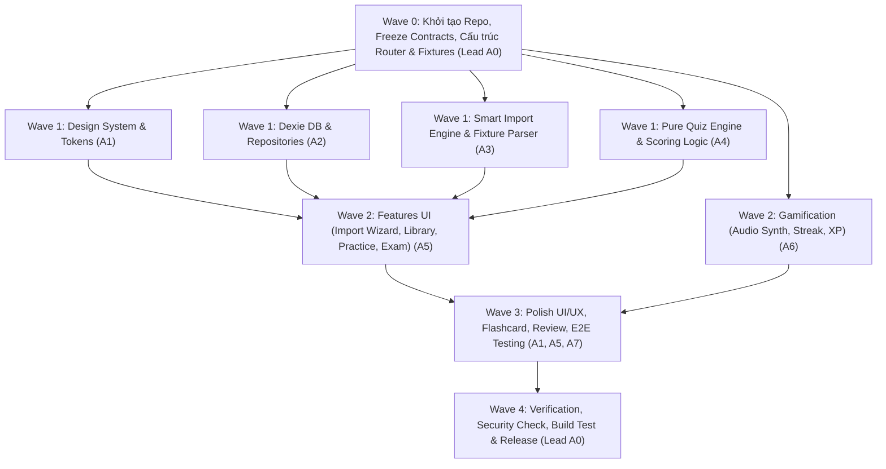

# Đặc Tả Thiết Kế Kỹ Thuật (Architectural Spec V2): QuizOnTap — Website Ôn Tập Trắc Nghiệm Local

> **Phiên bản**: 2.0 (Đồng bộ theo [QuizOnTap_MasterPlan_V2_ProUIUX_MultiAgent.md](file:///c:/Users/ASUS/Desktop/QuizOnTap/QuizOnTap_MasterPlan_V2_ProUIUX_MultiAgent.md))  
> **Ngày cập nhật**: 2026-10-22  
> **Trạng thái**: Đã phê duyệt kiến trúc V2 — Chuẩn bị lập Implementation Plan (Phase 2)  
> **Công nghệ lõi**: React 18+ (hoặc stable mới nhất), TypeScript (strict), Vite, Tailwind CSS v4 + Design Tokens, shadcn/ui + Radix primitives, Lucide Icons, Dexie (IndexedDB), Motion React, Web Audio API, Vitest, Playwright  
> **Mô hình thực thi**: Multi-Agent Decomposition (8 Roles A0–A7, 5 Waves 0–4, ranh giới module nghiêm ngặt)

---

## 1. Tầm Nhìn Sản Phẩm & Tinh Hoa Kế Thừa

### 1.1. Mục tiêu sản phẩm
QuizOnTap là một ứng dụng Single Page Application (SPA) *local-first*, chạy trực tiếp trên máy tính cá nhân (`localhost` qua Vite dev server hoặc tĩnh), hướng tới phong cách **"Focused Learning Studio"** — giao diện chuyên nghiệp, tối giản, thanh lịch, tinh tế, không màu mè kiểu game trẻ em nhưng vẫn giữ được nhịp độ học tập hứng khởi và phản hồi nhanh nhạy.

### 1.2. Tinh hoa chắt lọc từ 4 kho mã nguồn mở (Curated References)
1. **[DrillMCQ](https://github.com/aliflab/DrillMCQ)**:
   - **Smart Bulk Paste**: Dán văn bản tự do bóc tách thông minh;
   - **Quiz Library**: Quản lý đa bộ đề theo phân loại/chủ đề;
   - **Dual Shuffle**: Xáo trộn độc lập cả thứ tự câu hỏi VÀ thứ tự các phương án A-B-C-D;
   - **Drill Mode**: Ôn tập phản xạ lặp đi lặp lại với phản hồi tức thì.
2. **[QuizCreatorPlayer](https://github.com/bocaletto-luca/QuizCreatorPlayer)**:
   - **Visual Question Editor**: Soạn thảo trực quan, 1 chạm đổi đáp án đúng;
   - **100% Client-Side**: Hoạt động không cần backend, bảo toàn dữ liệu trên trình duyệt;
   - **Import / Export**: Dễ dàng sao lưu, chia sẻ đề thi qua định dạng chuẩn.
3. **[ClassQuiz](https://github.com/mawoka-myblock/ClassQuiz)**:
   - **Trực quan hóa phương án**: Huy hiệu rõ ràng (A, B, C, D);
   - **Thanh thời gian động (Dynamic Progress Bar)**: Biến chuyển màu mượt mà khi cận kề deadline;
   - **Web Audio Synthesis**: Âm thanh tổng hợp tự nhiên hoàn toàn offline, báo đúng/sai nhẹ nhàng, hỗ trợ Mute;
   - **Confetti Celebration**: Pháo hoa ăn mừng khi hoàn thành bài thi (kiểm soát số lượng, hỗ trợ reduced-motion).
4. **[Quiz Portal](https://github.com/Nexzen-Ai/quiz-portal)**:
   - **Hỗ trợ Import CSV / JSON / Markdown**: Nạp đa dạng nguồn tài liệu;
   - **Tags / Chapters**: Phân loại theo chương/chủ đề ôn tập;
   - **Analytics Breakdown**: Báo cáo sau thi chi tiết theo từng chương, phân loại câu sai, câu bỏ qua, câu gắn cờ 🚩.

---

## 2. Nâng Cấp Cốt Lõi V2 So Với V1 (Core Architectural Upgrades)

| Tiêu chí | Phiên bản V1 | Phiên bản V2 (Hiện tại) | Lợi ích kiến trúc |
|---|---|---|---|
| **Lưu trữ dữ liệu** | LocalStorage duy nhất | **IndexedDB qua Dexie** (`dexie-react-hooks`) | Chứa được hàng ngàn câu hỏi, hỗ trợ giao dịch (transactions), không bị chạm trần quota 5MB |
| **Trạng thái đáp án** | Bắt buộc có key (`correctOptionId: string`) | **Hỗ trợ câu thiếu key** (`answerStatus: 'missing' \| 'suggested' \| 'verified'`) | Nhập được tài liệu thực tế (chương chưa có đáp án), không tự bịa đáp án |
| **Định danh phương án** | 'A', 'B', 'C', 'D' | **Stable UUID (`option.id`)** | An toàn tuyệt đối khi đảo thứ tự lựa chọn (shuffle), không nhầm lẫn khi chấm bài |
| **Pipeline bóc tách** | Regex đơn giản một lượt | **State Machine Parser** với line numbers & preview | Xử lý xuống dòng nhiều đoạn, phát hiện lỗi cú pháp, hiển thị preview & sửa lỗi trước khi commit |
| **Dữ liệu thực tế** | Chỉ test mock 3-5 câu | **Bộ đề thực tế 179 câu, 6 chương** (104 có đáp án, 75 thiếu đáp án) | Tiêu chuẩn nghiệm thu thực tế, phát hiện cảnh báo thiếu hình ảnh / phương án khuyết |
| **Chính sách chấm điểm** | Tự động tính trên số câu trả lời | **Công thức chính thức**: `scoredCount = correct + incorrect + unanswered` | Không thưởng điểm cho câu bỏ trống, phân tách rõ `accuracyAmongAnswered` và `percent` |
| **UI/UX Direction** | Giao diện cơ bản | **Focused Learning Studio** (Tailwind v4, Radix, Calm Motion, WCAG 2.2 AA) | Cực kỳ chuyên nghiệp, responsive đa kích thước, dark/light theme chuẩn |
| **Tổ chức thực thi** | 5 subagents không rõ ranh giới | **8 Roles chuyên trách (A0–A7), 5 Waves (0–4)** | Không xung đột file, ranh giới module nghiêm ngặt, bàn giao qua Handoff Contract |

---

## 3. Mô Hình Dữ Liệu Chuẩn V2 (Data Contracts)

Tất cả các thành phần trong hệ thống phải tuân thủ nghiêm ngặt hợp đồng dữ liệu sau (sẽ được đóng băng tại `src/domain/contracts.ts`):

```typescript
export type QuestionKind = 'single' | 'multiple';
export type AnswerStatus = 'missing' | 'suggested' | 'verified';
export type AnswerOrigin = 'source' | 'manual' | 'ai-suggestion' | null;
export type SessionMode = 'practice' | 'exam' | 'mistakes' | 'flashcard';

export interface Option {
  id: string;           // UUID bền vững; KHÔNG dùng chữ cái A/B/C/D làm ID
  text: string;         // Nội dung phương án (hỗ trợ Markdown an toàn)
}

export interface SourceRef {
  filename?: string;
  chapter?: string;
  questionNumber?: number;
  lineStart?: number;
  lineEnd?: number;
  sourceHash?: string;
  warnings?: string[];
}

export interface Question {
  id: string;                           // UUID
  setId: string;                        // ID bộ đề sở hữu
  kind: QuestionKind;                   // 'single' | 'multiple'
  text: string;                         // Nội dung câu hỏi
  options: Option[];                    // Danh sách phương án lựa chọn
  correctOptionIds: string[] | null;    // null nếu answerStatus === 'missing'
  answerStatus: AnswerStatus;           // 'missing' | 'suggested' | 'verified'
  answerOrigin: AnswerOrigin;           // Nguồn gốc đáp án
  explanation?: string;                 // Lời giải thích / căn cứ
  chapterId?: string;                   // ID chương / chủ đề
  tags: string[];                       // Nhãn phân loại
  source?: SourceRef;                   // Truy vết dòng và nguồn nhập
  createdAt: number;                    // Epoch ms
  updatedAt: number;                    // Epoch ms
}

export interface QuizSet {
  id: string;                           // UUID
  title: string;                        // Tên bộ đề
  description?: string;                 // Mô tả
  schemaVersion: 2;                     // Định danh version hợp đồng
  createdAt: number;
  updatedAt: number;
}

export interface QuizSession {
  id: string;                                     // UUID phiên làm bài
  setId: string;                                  // Thuộc bộ đề nào
  mode: SessionMode;                              // 'practice' | 'exam' | 'mistakes' | 'flashcard'
  status: 'in-progress' | 'submitted' | 'expired' | 'abandoned';
  questionIds: string[];                          // Thứ tự câu hỏi đã chốt (snapshot)
  optionOrderByQuestion: Record<string, string[]>; // Thứ tự hiển thị phương án theo câu
  answersByQuestion: Record<string, string[]>;    // Lựa chọn của người dùng (UUIDs)
  flaggedQuestionIds: string[];                   // Các câu có gắn cờ 🚩
  startedAt: number;                              // Thời điểm bắt đầu
  deadlineAt: number | null;                      // Hạn nộp bài (áp dụng cho Exam)
  submittedAt: number | null;                     // Thời điểm nộp bài
  questionSnapshotVersion: number;
}

export interface ExamResult {
  sessionId: string;
  correct: number;
  incorrect: number;
  unanswered: number;
  unscored: number;                     // Số câu bỏ qua chấm do thiếu verified answer
  scoredCount: number;                  // Tổng số câu đủ điều kiện tính điểm = correct + incorrect + unanswered
  attemptedScoredCount: number;         // Số câu có làm bài = correct + incorrect
  accuracyAmongAnswered: number | null; // correct / attemptedScoredCount * 100
  percent: number | null;               // correct / scoredCount * 100 (null nếu scoredCount === 0)
  chapterStats: Record<string, { correct: number; scored: number }>;
}

export interface ParseIssue {
  code: string;
  severity: 'error' | 'warning' | 'info';
  lineStart: number;
  lineEnd?: number;
  questionDraftId?: string;
  message: string;
  fixSuggestion?: string;
}

export interface QuestionDraft {
  tempId: string;
  rawText: string;
  questionText: string;
  options: { label: string; text: string }[];
  detectedKeys: string[];
  explanation?: string;
  chapter?: string;
  sourceLineStart: number;
  sourceLineEnd: number;
  issues: ParseIssue[];
}

export interface ParseResult {
  drafts: QuestionDraft[];
  issues: ParseIssue[];
  sourceFormat: 'markdown' | 'txt' | 'json' | 'csv' | 'xlsx';
}
```

### Các bất biến dữ liệu (Data Invariants)
1. **Option IDs**: Tạo bằng UUID độc lập; không đổi khi shuffle hiển thị.
2. **Đáp án xác thực (`verified`)**: `correctOptionIds` phải khác rỗng và mọi ID trong đó phải thuộc `options`. Nếu `missing`: `correctOptionIds === null`. Trạng thái `suggested` không được tự ý chuyển thành `verified` trừ khi có thao tác người dùng duyệt.
3. **Nguyên tắc chấm thi**:
   $$\text{scoredCount} = \text{correct} + \text{incorrect} + \text{unanswered}$$
   $$\text{percent} = \frac{\text{correct}}{\text{scoredCount}} \times 100$$
   $$\text{accuracyAmongAnswered} = \frac{\text{correct}}{\text{correct} + \text{incorrect}} \times 100$$
   Câu `unscored` (chưa có verified key) hoàn toàn không được đưa vào mẫu số điểm thi chính thức.
4. **Snapshot bảo toàn phiên thi**: Khi bắt đầu một phiên làm bài (`QuizSession`), toàn bộ thứ tự câu hỏi và phương án được snapshot cố định; việc chỉnh sửa ngân hàng đề sau đó không được làm sai lệch kết quả phiên thi đã/đang diễn ra.

---

## 4. Kiến Trúc Ứng Dụng & Phân Vùng Module (Module Boundaries)

```text
quizontap/
├── AGENTS.md                          # Quy chuẩn điều phối Multi-Agent
├── PROJECT_PROGRESS.md                # Theo dõi tiến độ dự án
├── docs/
│   ├── superpowers/
│   │   ├── specs/                     # Bản đặc tả kỹ thuật (Spec V2)
│   │   └── plans/                     # Bản kế hoạch thực thi chi tiết (Implementation Plans)
│   ├── CONTRACTS.md                   # Hợp đồng dữ liệu cố định
│   └── handoffs/                      # Báo cáo bàn giao giữa các ticket
├── public/                            # Tài nguyên tĩnh, âm thanh, favicon
├── src/
│   ├── app/                           # Bootstrap, React Router, App providers, Error Boundary
│   ├── design/                        # Design system: tokens, primitives, typography, icons, layout
│   ├── domain/                        # Pure TypeScript: contracts, quiz engine, scoring, validation (No UI/DB)
│   ├── db/                            # Dexie IndexedDB schemas, repositories, migrations, backup/restore
│   ├── import/                        # State machine parsers (Markdown, Text, CSV, JSON), validator
│   ├── features/
│   │   ├── dashboard/                 # Thống kê tổng quan, nút tiếp tục học, CTA nạp đề
│   │   ├── library/                   # Quản lý danh sách bộ đề, chi tiết bộ đề, chương
│   │   ├── questions/                 # Question Editor, quản lý câu hỏi
│   │   ├── import-wizard/             # 5-step wizard: Upload -> Parse -> Preview -> Resolve -> Commit
│   │   ├── practice/                  # Chế độ Luyện tập (Drill), phản hồi tức thì
│   │   ├── exam/                      # Chế độ Thi thử, đồng hồ deadline, ma trận câu hỏi
│   │   ├── results/                   # Màn hình kết quả thi, phân tích theo chương, đối chiếu đáp án
│   │   ├── flashcards/                # Chế độ Lật thẻ 3D, tự đánh giá
│   │   ├── review/                    # Ôn tập các câu từng làm sai, đánh dấu thành thạo
│   │   └── settings/                  # Cài đặt theme, âm thanh, sao lưu JSON
│   ├── gamification/                  # Streak, XP calculator, Web Audio synth, confetti controls
│   ├── shared/                        # Markdown renderer an toàn, utility hooks
│   └── test/                          # Test fixtures (bộ đề 179 câu, malformed samples)
├── e2e/                               # Playwright test specs
├── package.json
└── vite.config.ts
```

### Ranh giới module bắt buộc:
- `src/domain/`: Chỉ chứa pure functions, deterministic logic; tuyệt đối không import React, Dexie, window, hay DOM.
- `src/db/`: Quản lý truy xuất IndexedDB qua Repositories; không phụ thuộc vào React Components.
- `src/import/`: Chứa bộ parser thuần và validator; UI wizard chỉ gọi API/methods từ module này.
- `src/features/`: Tầng giao diện người dùng; tiêu thụ domain types và database repositories.
- `src/design/`: Chứa design tokens và UI primitives dùng chung; không truy cập trực tiếp database.

---

## 5. Đặc Tả Bộ Smart Import Engine & Bộ Dữ Liệu Thật

### 5.1. Pipeline 9 bước xử lý tài liệu
1. **Read**: Đọc chuỗi ký tự UTF-8, lọc ký tự điều khiển lạ, chuẩn hóa newline (`\r\n` -> `\n`).
2. **Detect**: Nhận diện cấu trúc Chương (`# Chương I`, `## Chương 2`), Tiêu đề câu (`Câu 1:`, `1.`), Phương án (`A.`, `B.`, `- A.`), Đáp án (`Đáp án: A`), Lời giải (`Giải thích:`).
3. **Segment**: Máy trạng thái (State Machine) chuyển đổi qua các trạng thái: `OUTSIDE` -> `QUESTION` -> `OPTIONS` -> `ANSWER` -> `EXPLANATION`.
4. **Normalize**: Giữ nguyên vẹn dấu tiếng Việt, công thức, ký tự đặc biệt; loại bỏ khoảng trắng dư thừa.
5. **Map**: Chuyển đổi thành danh sách `QuestionDraft`, lưu vết số dòng bắt đầu (`lineStart`) và kết thúc (`lineEnd`).
6. **Validate**: Kiểm tra các quy tắc: đủ từ 2 phương án trở lên; phương án trùng lặp; đáp án có nằm trong danh sách lựa chọn; gắn cờ `missing` nếu tài liệu không ghi đáp án.
7. **Preview**: Hiển thị bảng Live Preview phân loại: Hợp lệ (Valid), Cần bổ sung key (Needs Review), Lỗi (Invalid).
8. **Commit**: Thực hiện giao dịch nguyên tử (Atomic Transaction) ghi toàn bộ bộ đề và danh sách câu hỏi vào IndexedDB; rollback nếu xảy ra sự cố.
9. **Report**: Xuất báo cáo tổng kết số câu nạp thành công, số câu thiếu key, số lỗi đã bỏ qua.

### 5.2. Tiêu chuẩn nghiệm thu trên Fixture thực tế (179 câu - 6 chương)
Tài liệu thực tế: `Tài liệu ôn tập Kinh tế học và Môi trường`:
- **Chương 1 (Tổng quan kinh tế học)**: 10 câu — Nguồn không có đáp án (`missing`).
- **Chương 2 (Kinh tế học vi mô)**: 30 câu — Nguồn không có đáp án (`missing`); Câu 17 có cảnh báo thiếu hình vẽ.
- **Chương 3 (Kinh tế học vĩ mô)**: 35 câu — Nguồn không có đáp án (`missing`).
- **Chương 4 (Môi trường)**: 35 câu — Có đầy đủ đáp án trong nguồn (35 verified).
- **Chương 5 (Ô nhiễm & BVMT)**: 48 câu — Có đầy đủ đáp án trong nguồn (48 verified); Câu 30 có 3 lựa chọn (A/B/C).
- **Chương 6 (Phát triển bền vững)**: 21 câu — Có đầy đủ đáp án trong nguồn (21 verified).
- **Tổng cộng**: **179 câu** (104 câu có đáp án từ nguồn, 75 câu thiếu đáp án).
- **Acceptance Gate**: Parser bắt buộc phải nhận diện chính xác 179 câu, chia đúng 6 chương, phân loại đúng 104 `verified` và 75 `missing`, tuyệt đối không làm rơi rớt dòng nào.

---

## 6. Lộ Trình Triển Khai Multi-Agent (5 Waves)

Hệ thống được phân rã thành 8 vai trò (Roles) và thực thi qua 5 đợt (Waves) tuần tự, có kiểm soát ranh giới nghiêm ngặt:



### Chi tiết các đợt (Waves):
- **Wave 0 (Bootstrap & Freeze)**:
  - Khởi tạo Git repo, Vite React TypeScript (strict mode), Tailwind CSS v4, Lucide Icons, Dexie, Vitest, Playwright.
  - Đóng băng hợp đồng dữ liệu `src/domain/contracts.ts` và bộ fixture mẫu 179 câu.
  - Cấu trúc khung routing, layout shell, error boundary.
- **Wave 1 (Foundation Modules - Song song độc lập)**:
  - **A1 (UI System)**: Xây dựng bảng design tokens, typography tiếng Việt chuẩn, nút, thẻ, dialog, drawer, toast, skeleton.
  - **A2 (Storage)**: Khởi tạo schema Dexie, migration v1->v2, repositories CRUD, transaction commit, backup JSON export/import.
  - **A3 (Parser)**: Xây dựng State Machine Parser cho Markdown/Text/CSV/JSON, vượt qua 100% acceptance của fixture 179 câu.
  - **A4 (Engine)**: Xây dựng hàm tạo session, dual shuffle có seed, công thức tính điểm chính thức, logic deadline timer.
- **Wave 2 (Experience & Feature Wiring)**:
  - **A5 (Feature UI)**: Ghép nối Import Wizard 5 bước; Thư viện bộ đề; Question Editor; Chế độ Luyện tập; Chế độ Thi thử có ma trận câu hỏi và cờ đánh dấu.
  - **A6 (Gamification)**: Bộ âm thanh Web Audio API thuần, tính toán Streak theo ngày local, bảng tính XP/Combo, pháo hoa hoàn thành bài thi.
- **Wave 3 (Advanced Modes & Polish)**:
  - Chế độ Flashcard lật thẻ 3D; Chế độ Ôn lại câu sai (Mistake Review); Trang Thống kê chuyên sâu (Insights).
  - Tinh chỉnh tương tác Micro-animations (Calm motion), kiểm tra độ tương phản WCAG 2.2 AA, responsive trên mọi kích thước (320px đến 1440px).
- **Wave 4 (Verification & Release Gate)**:
  - Chạy toàn bộ test suites: `npm run typecheck`, `npm run lint`, `npm run test:unit`, `npm run test:e2e`, `npm run build`.
  - Kiểm thử phục hồi sao lưu (Backup & Restore roundtrip), bảo mật XSS input, không rò rỉ bộ nhớ.
  - Cập nhật tiến độ dự án `PROJECT_PROGRESS.md` và hoàn tất tài liệu hướng dẫn bàn giao.

---

## 7. Tiêu Chuẩn Nghiệm Thu & Đảm Bảo Chất Lượng (DoD & Acceptance Gates)

1. **Gate 1 — Độ chính xác dữ liệu (Data Integrity)**:
   - Nạp fixture 179 câu phải hiển thị chính xác: 6 chương, 104 câu có đáp án từ nguồn, 75 câu thiếu đáp án.
   - Không câu hỏi nào bị mất mát nội dung, không sai lệch vị trí dòng.
2. **Gate 2 — Logic thi cử & Chấm điểm (Scoring Correctness)**:
   - Bài thi 20 câu: làm đúng 18 câu, bỏ trống 2 câu -> Điểm số chính thức là `18/20 = 90%` (không tính bỏ trống là đúng hoặc loại khỏi mẫu số).
   - Tải lại trang (F5/Reload) trong khi đang thi: giữ nguyên trạng thái câu đã chọn và thời gian đếm ngược chính xác theo `deadlineAt`.
3. **Gate 3 — Chất lượng giao diện (Pro UI/UX)**:
   - Không bị vỡ khung ở kích thước 320px, 375px, 768px, 1024px và 1440px.
   - Dark mode và Light mode đều đạt chuẩn tương phản chữ WCAG 2.2 AA (≥ 4.5:1).
   - Hỗ trợ đầy đủ phím tắt bàn phím (1-4, A-D, Space, Mũi tên) và tuân thủ chế độ `prefers-reduced-motion`.
4. **Gate 4 — Kiểm thử tự động (Automated Verification)**:
   - 100% unit tests của Domain, Parser và Storage pass.
   - Playwright E2E vượt qua toàn bộ luồng cốt lõi: Import đề -> Luyện tập -> Thi thử -> Nộp bài -> Xem lại câu sai -> Xuất/nhập file sao lưu.
